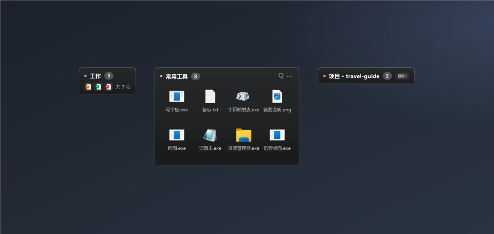
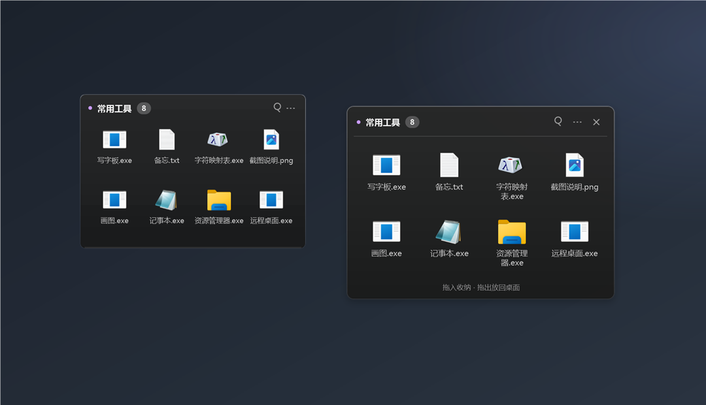
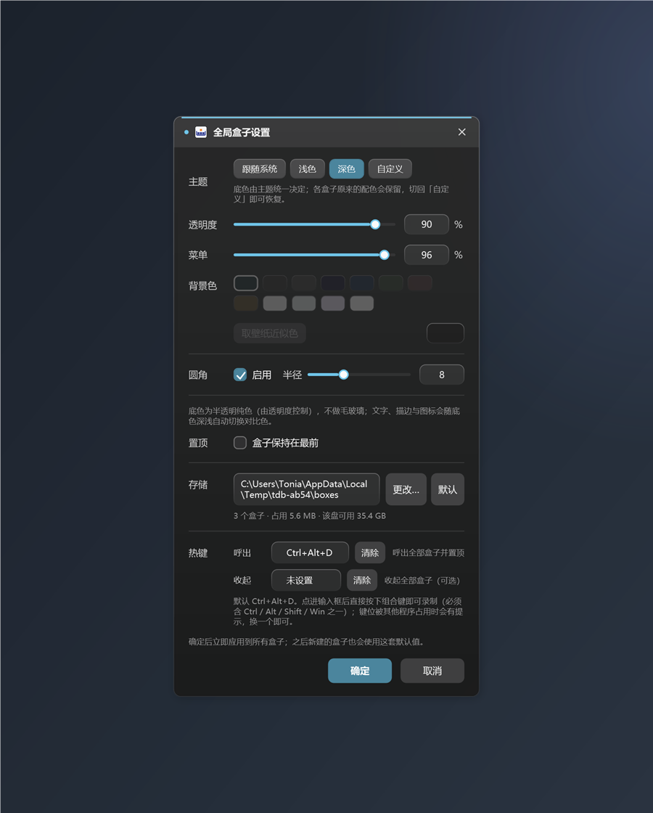
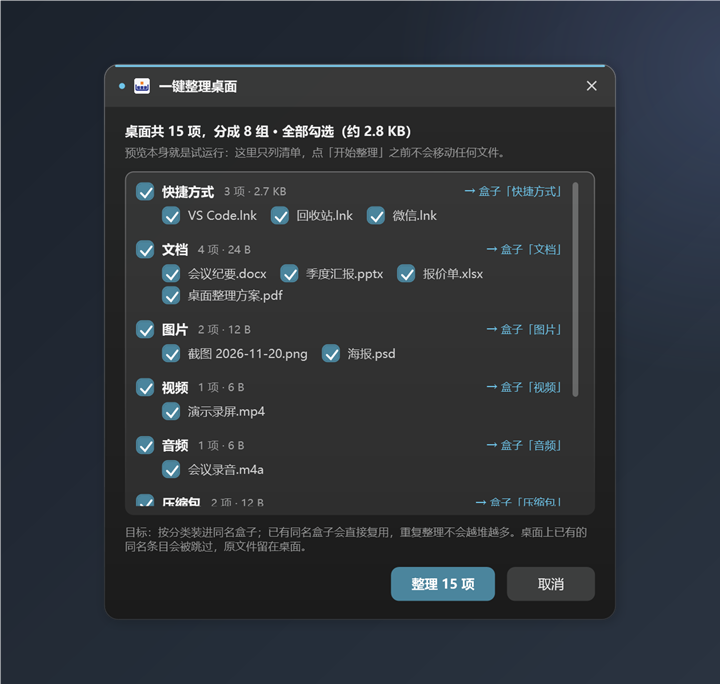

# Tonia-DeskBox

Windows 11 桌面收纳小工具：把桌面快捷方式/文件拖进一个个「盒子」，桌面只留壁纸。
纯离线、零第三方 NuGet 依赖（.NET 8 BCL + Win32 P/Invoke），MIT 协议。



<p align="center">
  
  
</p>

<p align="center">
  <sub>左：展开面板（悬停/框选/拖入拖出）　右：全局设置（主题 / 外观 / 存储 / 热键）</sub>
</p>

## 能做什么

- **收纳**：拖进来 = 真的把文件移进盒子目录；拖出去/右键「放回桌面」原路返回。
- **映射**：不想搬家？把一个已有文件夹变成一个盒子（Folder Portal），文件原地不动。
- **一键整理**：扫桌面 → 按类型分组 → 逐条勾选 → 批量搬进同名盒子，重复执行不会越堆越多。
- **收放自如**：`Ctrl+Alt+D` 一键呼出全部盒子并置顶，再按一次/另一个键收起。
- **外部变化感知**：往盒子里拷文件、或在资源管理器里删掉盒内文件，角标与图标网格立刻跟上。

## 运行环境

- Windows 10 1809+ / Windows 11。不再依赖 DWM 亚克力 / Mica，任何支持 .NET 8 的 Windows 都能得到一致外观。
- **安装包自带 .NET 8 运行时**（self-contained 单文件），装机用户无需预装任何运行时。
- 开发构建需要 .NET 8 SDK；仓库 `global.json` 固定 8.0 主版本并允许同主版本内滚动。

## 构建与发布

```bash
# Debug：多文件输出
dotnet build ToniaDeskBox.sln -c Debug
# → src/ToniaDeskBox/bin/Debug/net8.0-windows/ToniaDeskBox.exe

# 单文件发布（交付形态）：自带运行时 + LZMA 压缩，约 64 MB
dotnet publish src/ToniaDeskBox/ToniaDeskBox.csproj -c Release -r win-x64 --self-contained true -o publish
# → publish/ToniaDeskBox.exe
```

> `PublishSingleFile` / `SelfContained` 只在 Release 配置生效，`dotnet build -c Debug` 得到的是多文件产物，
> 两者输出路径不同，写脚本时别混用。

### 打安装包

```bash
winget install JRSoftware.InnoSetup            # 只需一次
ISCC.exe installer\ToniaDeskBox.iss /DAppVersion=0.2.0
# → dist/ToniaDeskBox-Setup-0.2.0.exe
```

安装包是**每用户安装**（`%LOCALAPPDATA%\Programs\Tonia-DeskBox`，不弹 UAC），
`AppId` 固定不变，因此再运行一次新版本安装包就是原地覆盖升级，不会装出第二份。

### 发布新版本（「检查更新」靠它生效）

程序查的是 **GitHub Releases 的最新一条**（公开仓库，匿名可读，不需要令牌）。发版只有一步：

```bash
git tag v0.3.0 && git push origin v0.3.0
```

推 tag 触发 `.github/workflows/release.yml`：按 tag 推导版本号 → 发布 self-contained 单文件 →
编译安装包 → 把 `ToniaDeskBox-Setup-<版本>.exe` 传进 Release。
之后用户在托盘点「检查更新…」即可看到版本说明并一键升级。

版本号由 CI 从 tag 统一注入（`-p:Version=` 与 `ISCC /DAppVersion=`），
本地手工构建时则取 `csproj` 的 `<Version>` 与 `iss` 的 `AppVersion` 默认值，两个默认值请保持一致。

不发布也能自检整条链路（解析、版本比较、下载、大小与 SHA256 校验）：

```bash
dotnet run --project tools/UpdateProbe -- --download
# 想验证"有新版本"的分支，可用 TONIA_UPDATE_API 指向本地假数据
```


## 运行

双击 exe 即可。**不要以管理员身份运行**（权限不一致会导致盒子挂不上桌面、拖放失败）。

- 首启：生成 **1 个空盒「新建盒子」**，默认位置 `(120, 120)`；不自动创建示例盒、不自动排列
  —— 想一步到位就用托盘的「一键整理桌面…」。
- 盒子是 Progman 的 owned window，不进任务栏 / Alt+Tab；`Process.MainWindowHandle = 0` 属正常，不是启动失败。
- 托盘右键：新建盒子、**映射文件夹**、显示/隐藏全部、**一键整理桌面**、整理盒子、全局盒子设置、
  开机自启、打开数据目录、导出备份、导入备份、检查更新、退出。
  菜单为 WPF 主题菜单，和盒子 / 面板 / 设置窗口同一套外观。**左键双击托盘 = 呼出全部盒子**。

## 一键整理桌面



托盘 →「一键整理桌面…」。三个步骤，前两步都不动文件：

1. **扫描**：只扫当前用户的桌面**顶层**（公用桌面的系统快捷方式需要管理员权限，不碰），
   跳过 `desktop.ini`，跳过数据根与配置目录本身（绿色版把数据根放在桌面时不会自己吃自己）。
2. **预览**：按扩展名分成 快捷方式 / 文档 / 图片 / 视频 / 音频 / 压缩包 / 文件夹 / 其他，
   每一条都能单独勾选，组标题又是整组的全选开关；底部实时显示「已勾选 N 项，共 X MB」。
   这一屏就是**试运行** —— 没点「整理」之前，桌面上一个文件都不会移动。
3. **执行**：按分类搬进同名盒子（已有同名盒子就直接复用，所以第二次整理是"归位"而不是"又建一堆盒子"）。
   搬运在后台线程进行，进度可取消；盒内已有同名条目时**跳过**而不是覆盖，桌面那份原样保留。

## 文件夹映射（Folder Portal）

托盘的「映射文件夹…」把任意一个已有目录变成盒子：盒子里显示的就是它，**文件一个都不搬**。

- 之前只有"移动"一种语义，把 `D:\项目\xxx` 拖进来等于真搬家，IDE 里的路径全废 ——
  所以用户只敢收纳快捷方式，工具被自己限制在最小场景。映射解决了这件事。
- 映射盒标题右侧有「映射」标记，右键菜单是「打开映射的文件夹 / 更改映射目标」，而不是「打开数据目录」。
- 映射盒**改名只改显示名**，不会重命名或移动目标文件夹；
  删除时只移除这扇"窗"，目标目录里的文件不会被删（会单独确认一次）。
- 同一个目录只允许映射一次；目标目录被拔盘/改名时，盒子会明确提示"当前不可用"，而不是显示成空盒。

## 全局热键

| 键 | 动作 | 默认 |
|---|---|---|
| 呼出 | 显示全部盒子并提到桌面层最前 | `Ctrl+Alt+D` |
| 收起 | 隐藏全部盒子 | 未设置（不占键位） |

在「全局盒子设置 → 热键」里点输入框**直接按组合键**即可录制，也可以清除。
注册失败最常见的原因是键位被别的程序占用 —— 设置窗口会就地说明并让你换一个，而不是静默失效。

## 盒目录监听

每个盒子（含映射盒）挂一个 `FileSystemWatcher`：外部往盒目录里拷文件、
或者在资源管理器里删掉盒内文件，角标计数与图标网格会在 **300ms 内**自己更新，不用重启。

- 300ms 防抖：解压/批量粘贴会在几十毫秒内打出上百条事件，不合并会把 UI 线程打满。
- 自身操作（拖入、拖出、放回桌面、一键整理）期间**抑制回调**：
  这些变动是自己造成的，此时重建列表会打断正在进行的拖拽。
- 目录还不存在（新盒子第一次拖入前）或 watcher 缓冲溢出时会自动重挂。

## 备份与恢复

导出（托盘 → 导出备份）把**数据根全部文件 + `config.json`** 打成一个 zip，包内用固定路径
`_config/config.json` 存放配置——没有它，换机器恢复后只剩一堆文件、没有盒子结构。

导入（托盘 → 导入备份）先**只读体检**包内容，再让你选导入方式：

| 方式 | 行为 | 适合 |
|---|---|---|
| **合并**（默认） | 现有盒子与文件原样保留，备份里的盒子追加为新盒子；重名自动改成 `名称 (2)`，各走独立目录 | 从旧电脑搬运一部分盒子过来 |
| **覆盖** | 用备份整体替换当前数据；替换前把旧数据整体改名到 `数据根.before-import-<时间戳>`，配置另存 `config.before-import-*.json` | 换机恢复 / 回滚到某次备份 |

三条实现约束（别破坏，否则"导入"会变成"删数据"）：

1. **先解压到数据根旁边的临时目录**，解压失败时现有数据毫发无伤；临时目录必须与数据根同卷，rename 才原子。
2. **只做整目录改名，绝不逐文件删除**——旧数据永远是"改名挪走"，不是删掉；失败按相反顺序回滚。
3. **配置里的 `DataRoot` 不采用备份包里的值**：那是导出机器的路径，照搬会让所有盒子指向不存在的目录。自启状态同样以本机注册表为准。

导入同样在后台线程执行（盒子可能是近 1 GB 的真实文件），UI 全程可取消。

## 数据目录（重要）

盒子收纳的是**真实文件**（拖进去＝把文件移动进来），可能几百 MB 甚至更大，因此
「配置放哪」与「盒子文件放哪」是两件事，**故意分开**：

| 内容 | 位置 | 是否可改 |
|---|---|---|
| 配置 / 备份 / 日志 | 固定目录：**安装版** `%LOCALAPPDATA%\Tonia-DeskBox\`、绿色版 `exe 同级`、开发版 `%LOCALAPPDATA%\Tonia-DeskBox\` | 否（只有几 KB，固定住才能始终找得到） |
| 盒子文件（`盒子名\文件…`） | **数据根**，默认 `固定目录\boxes`（开发版 `boxes-dev`） | **是**，全局盒子设置 → 存储 → 更改 |

为什么必须拆开：`config.json` 里记着数据根在哪。如果配置本身也放在数据根里，
把数据根挪到 D 盘之后，下次启动就不知道该去哪儿读配置了。

### 安装版与覆盖升级

安装目录里只有 `ToniaDeskBox.exe` 和一个 `app-installed.marker` 标记文件；
程序看到标记就把配置与数据放到 `%LOCALAPPDATA%\Tonia-DeskBox\`，**不写安装目录**。
这条规则是整个升级安全的底座：

- 覆盖安装只替换安装目录里的 exe，用户数据不在它的作业范围内；
- 卸载同样不碰用户数据，卸载后重装新版本，盒子照旧；
- 换机/换盘：把 `%LOCALAPPDATA%\Tonia-DeskBox` 整个拷走即可；
- 绿色版（exe 同级自带 `config.json`）优先按便携模式运行，不受安装版影响。

程序内「检查更新…」下载的安装包放在 `%LOCALAPPDATA%\Tonia-DeskBox\updates\`，
只保留最新一个；更新时会先写盘配置，再以 `/SILENT` 覆盖安装，装完自动重启程序。

### 更改存储位置

设置里选新目录后会走「**复制 → 校验 → 切配置 → 删源**」四步，任何一步失败源目录都完整：

1. 预扫描文件数与总字节，确认目标盘剩余空间 ≥ 1.05 倍；
2. 逐文件复制（同名同大小直接跳过，中断后重跑可续传），期间显示进度并可取消；
3. 重新扫描目标，文件数与字节数都要对得上才算成功；
4. 配置切到新根、写盘成功后，才删除原位置的盒子目录。

拒绝的目标：当前根本身、当前根的子目录/上级目录、磁盘根目录（`D:\`）、配置目录及其上级。
数据根**不可用**（外置盘没插、目录被删）时不会崩：本次运行回退到默认位置并写日志，
配置里的原值保留，盘插回来即恢复。

迁移时顶层的 `config.json*` / `*.log` 不参与搬运（它们是配置与日志，不是盒子内容）。

### 旧版本兼容

早期版本把 `config.json` 放在数据目录里。升级后若固定目录没有配置，会把
`boxes-dev\config.json` 复制过来，并把数据根指回原目录 —— 只复制、不删除，用户无感。

目录内容：`config.json`、`config.json.bak`、`error.log`，以及数据根下的每个盒子一个同名子文件夹
（**映射盒不建子文件夹**，只在配置里记一条目标路径）。

### 配置容错

- `config.json` 损坏 → 先另存为 `config.corrupt-<时间戳>.json` 并移除主文件，再从 `config.json.bak` 恢复，随后重建主文件。
- 保存时只有当旧主文件本身是合法 JSON 才更新 `bak`，**损坏内容永远不会覆盖唯一备份**。
- 读取/保存异常与恢复动作写入 `error.log`；导出 zip 会自动排除 `error.log`、损坏副本、`.tmp` 和 zip 自身。
- 盒子名做安全规范化（拒绝 `.` / `..`、路径分隔符、绝对路径、Windows 保留名，重名自动消歧），避免手工编辑配置造成路径越界。

## 统一外观样式（Theme.*）

**一套样式，四处共用。** `Services/AppearanceTheme.cs` 是唯一真源：由「底色 + 透明度 + 分类色」
推导出整套 `Theme.*` 笔刷（表面、描边、文字三级、图标、填充、分隔线、分类色、按钮动作色等）。
折叠盒子、展开面板、盒子设置、全局盒子设置、右键菜单都只认这套键。

- **半透明底色，不做毛玻璃**：底色是带 alpha 的纯色微渐变，透明度滑杆只改底色 alpha；
  窗口级 `Opacity` 恒为 `1.0`，文字/图标保持满不透明度（旧版整窗 Opacity 会把文字一起变淡）。
  已删除 DWM 亚克力与 `BoxConfig.Acrylic`，Win11 22H2 也不再是运行前提。
- **自动对比度**：按底色 sRGB 相对亮度判定（阈值 `0.62`）。浅色底（`#FFFFFF`、`#F2F2F2`、`#DCE3E8`…）
  用深墨 `#18202C` 系列前景，深色底用白色系列前景；描边、图标、hover/选中填充、色板选中环同理。
  白底白字的根因是 XAML 里到处硬编码 `#F2FFFFFF`，现在全部改为 `DynamicResource Theme.*`。
- **两级分类色**：`Theme.Accent`（柔和，用于色条/色点/框选/滑杆）与 `Theme.Action`（压暗 32%，
  用于按钮、勾选框等要放白字的元素），保证白字对比度。
- **设置窗口也是同一套**：两个设置窗口不再用固定 `#F2222A38`，改为同一份 `ChromeBorder + ShadowCaster`
  结构、同一套主题笔刷；切换色板时对话框自身实时换肤，所见即所得。文字密集，透明度下限取 `0.90`。
- **原地刷新**：`Update()` 直接替换窗口根资源字典里的 `Theme.*` 项，`DynamicResource` 自动刷新，
  不重建窗口。注意**不能**用 `MergedDictionaries` 存主题——合并字典会被 WPF Seal，笔刷被冻结后就改不动了。
- **右键菜单**跟随所属盒子的主题（`AppearanceTheme.AttachMenu`），但**不透明度是独立设置**：
  全局设置 → 菜单，默认 `0.96`（盒子默认 `0.85`）。菜单是文字密集的浮层，跟盒子一样透就没法读了。
- **菜单压住别的卡片时直接转全不透明**：`Opened` 之后量一次自己的屏幕矩形（`OverlapsOtherCard`），
  与其它窗口相交超过 6×6 就把 alpha 抬到 1.0。只排除菜单所属的那个盒子——菜单本来就该盖在它上面。
- **子菜单必须由模板自己提供 `PART_Popup`**：`MenuItem` 的 ControlTemplate 只认这个名字来挂
  `IsSubmenuOpen`。之前的模板没有 Popup，带子项的「展示方式」点下去毫无反应，连箭头都没有。
  勾选框默认 `Hidden` 而不是 `Collapsed`，否则有勾/无勾的两行文字左边缘会错开。
- `ToolTip` 走应用级默认深色主题。
- **托盘右键菜单**也是同一套：`TrayService` 已弃用 WinForms `ContextMenuStrip`，改用 WPF `ContextMenu`，
  跟随全局默认外观（没配过全局设置时取第一个盒子的外观）。托盘菜单没有父窗口，用一个 1×1 全透明宿主窗口
  作为 `PlacementTarget`，弹出前先激活宿主、收起后把前台还给原窗口；**不能在弹出后再抢前台或 `Focus()`**，
  否则 Popup 会立刻失去捕获而自动关闭。
- **托盘图标不再依赖 WinForms**：`Services/TrayIcon.cs` 直接调 `Shell_NotifyIcon`，消息由 HWND_MESSAGE
  消息窗口接收；ICO 字节经 `CreateIconFromResourceEx` 转成 HICON（按 16px 挑最合适的那张）。
  explorer 重启后靠 `TaskbarCreated` 广播自动重挂图标。
- **样式集中在一个字典**：`Themes/SharedStyles.xaml`（滑块、勾选框、输入框、滚动条、按钮、色板、右键菜单、
  菜单项、分隔线、工具提示）；`App.xaml` 只负责合并它，`AppearanceTheme` 只负责 `Theme.*` 笔刷。
  这样样式可独立加载（验证宿主直接 `Application.LoadComponent` 这个字典，不会触发真实启动逻辑）。
- 面板关闭统一走 `ClosePanel()`：失焦、Esc、×、点盒子切换可能在同一帧重复触发 `Close()`，
  WPF 在 Closing 期间再调 `Close()` 会抛 `InvalidOperationException`，曾经弹全局错误框。

### 深浅色主题（ThemeMode）

全局设置里可选四种模式，底色由谁决定一目了然：

| 模式 | 底色来源 | 色板 |
|---|---|---|
| 自定义（默认） | 各盒子自己的 `BackColor` | 可选 |
| 浅色 | `#F3F3F3` | 锁定 |
| 深色 | `#202020` | 锁定 |
| 跟随系统 | 读 `AppsUseLightTheme`，切换时实时响应 | 锁定 |

- **浅/深色取的就是 Win11 任务栏的表面色**（`#F3F3F3` / `#202020`），不是纯白纯黑，贴在桌面上
  与任务栏是同一档灰。配合收窄后的底色微渐变（浅色 ±6、深色 +10/−6），盒子不会比任务栏"浮"出来。
- **主题不写盒子数据**：`ThemeService.ResolveColor()` 在渲染时把 `BoxConfig.BackColor` 解析成实际生效的颜色，
  盒子自身的配色原样保留。所以从「浅色」切回「自定义」，每个盒子原来的颜色立刻回来，不会丢。
- **单一决策点**：`AppearanceTheme.Update(BoxConfig)` 走 `ThemeService.ResolveColor`，盒子 / 面板 / 右键菜单 /
  托盘菜单 / 设置窗口全部自动跟随，不需要各窗口各写一遍。
- **跟随系统**：`ThemeService` 订阅一次 `SystemEvents.UserPreferenceChanged`（不再是 `AppIconService` 自己订阅），
  系统切换后广播 `Changed`，`App` 负责重刷应用级笔刷、图标版本和所有盒子窗口。
- **图标也跟着主题**：显式选浅/深色时用对应图标，自定义/跟随系统时看系统深浅。
- 选「浅色/深色/跟随系统」时色板与「取壁纸近似色」变灰禁用，并说明「切回自定义即可恢复」；
  单盒设置窗口同样禁用并给出提示。

## 应用图标


- 设计原图：`assets/icons/light.png`（浅色）、`dark.png`（深色），2048×2048，仅作素材留档、不参与编译。
- 运行时资源：`src/ToniaDeskBox/Assets/app-light.ico` 与 `app-dark.ico`，均含 16/24/32/48/64/128/256 多尺寸，圆角外透明。
- **exe 文件图标**：`src/ToniaDeskBox/app.ico`（浅色版），编译期写入 Win32 资源，不随主题变化。
- **窗口与托盘图标**：`AppIconService` 读取 `HKCU\...\Themes\Personalize\AppsUseLightTheme`，
  浅色系统用浅色版、深色系统用深色版；设置窗口标题栏图标通过 `DynamicResource AppIcon` 刷新，托盘订阅主题事件即时切换。
  托盘不再经由 GDI+：`AppIconService.LoadTrayIconBytes()` 直接把 ICO 字节交给 `TrayIcon` 转 HICON。

## 盒子外观与三种展示方式

- 背景与描边来自 `Theme.Surface` / `Theme.Border`（按 `Box.BackColor` 生成的半透明上下渐变），
  底部一条内暗线；**不使用外扩投影**，避免改变 `SizeToContent` 尺寸与吸附坐标。
  外观由 `BoxWindow.ApplyAppearance()` → `AppearanceTheme.Update()` 在运行时写入窗口资源，
  只改 XAML 里的 `Background` / `BorderBrush` 会被交互态覆盖。
  内边距 `12,10` 与面板 `Root` 对齐，两块卡片并排时才不会因 2px 差异被看成两种东西。
- 分类色由 `AppearanceTheme.AccentOf()` 按盒子名做稳定哈希，从 6 色柔和调色板取色：**改名会换色**。
  当前没有独立配置项；如需固定颜色，后续可加 `BoxConfig.AccentColor` 并接入设置窗口色板。
  分类色**只用在标题前的色点**：数量徽标、映射标签都是中性填充，一张卡上只留一个彩色锚点。
  早先的顶部 2px 分类色条已删除——它没有功能含义，却是整张卡最饱和的颜色。
- 展示方式由 `BoxConfig.DisplayMode` 决定，三档**对普通盒与映射盒一视同仁**：
  | 档位 | 外观 | 标题栏按钮 | 点盒子 |
  |---|---|---|---|
  | `Preview` | 标题 + 最多 3 个缩略图 + 「共 N 项」 | 无 | 打开/收起面板 |
  | `TitleOnly` | 只有一行标题（空盒多一行「拖放文件到这里」） | 无 | 打开/收起面板 |
  | `Content` | 标题 + 内嵌图标网格，可拖右下角改大小 | 搜索 + 「⋯」 | 打开/收起面板 |
  - **拖动与点击共用同一个位移阈值**（`ClickThreshold = 6`）：没挪动就是点击、开面板，挪了就只是移动。
    因此光标**始终是普通箭头**，不会在悬停时变成四向箭头——光标不该替用户判断"这里只能拖"。
  - 搜索与「⋯」只挂在 `Content` 档的盒子上（它的内嵌网格没有自己的标题栏）；
    另外两档点开面板就有这两个入口。放大镜在面板没开时开「搜索态面板」（只有搜索栏 + 结果），
    面板已开则就地展开搜索栏。
  切换入口：右键菜单 → 展示方式，或 盒子设置 → 展示。
- 空盒计数徽标降到 45% 不透明度；悬停时背景提亮，拖入文件时描边切换为分类色并把提示改成
  「松开鼠标即可收纳」。拖离后恢复到悬停态，不会直接跳回常态。
- **缩放用屏幕光标的绝对位移**：手柄长在窗口右下角，窗口一变宽手柄就跟着右移；
  鼠标不动时相邻两帧的相对位移会一正一负，宽度就在两档之间来回跳。
  `OnResizeDrag` 因此记录 `DragStarted` 时的光标屏幕坐标，用"当前光标 − 起点"算增量，
  对「手柄跟着窗口跑」这个反馈环免疫。
- **宽度吸附到整列**（`Services/BoxMetrics.cs`）：`Content` 档的宽度只能是 `列数 × 80 + 26`
  （26 = 左右各 1px 描边 + 12px 内边距），拖动改宽时每跨过一整列才变一次。
  之前宽度是逐像素跟手的，换行点在临界宽度上来回跳，视觉上就是盒子在抖；
  顺带也解决了「最后一列右边永远空一截」。
  少算那 1px 描边会让四列差 2px 而退回三列，`BoxMetrics` 里对这点有注释。

## 展开面板外观

- **投影与内容分层**：`ShadowCaster`（纯色矩形 + `DropShadowEffect`）与 `Root`（全部文字/图标）是同级的两个 Border。
  `Effect` 会把整棵子树先栅格化成中间位图，若挂在内容容器上会让文字二次采样发虚；拆层后文字走正常渲染路径。
  面板仍是分层窗口（`AllowsTransparency=True`），WPF 在该模式下不支持 ClearType，因此另用
  `TextFormattingMode=Display`、`UseLayoutRounding` 补足观感。
- 两层都用 `Theme.Surface` / `Theme.ShadowFill`：`ShadowCaster` 的填充是**低 alpha** 的，
  只给 `DropShadowEffect` 提供轮廓，不会变成不透明背板把半透明底色堵死。
- **与别的卡片重叠时转成全不透明**：`PanelWindow` 每 200ms 量一次自己（去掉 18px 投影外圈）与
  `Application.Current.Windows` 里其它窗口的相交面积，超过 6×6 就把表面 alpha 抬到 1.0。
  两层半透明叠在一起谁的字都读不清，被压住的那个必须让位。判据用面积而不是"是否相交"，
  是因为圆角与阴影贴边会产生 1–2px 的假重叠。
- 背景、描边、文字、图标全部走 `Theme.*`；`PanelWindow.ApplyTheme()` 只负责更新主题与圆角，
  圆角跟随 `Box.CornerSize`（`+2` 后钳制到 10～18）。盒子设置改动时 `RefreshTheme()` 让已打开的面板同步换肤。
- 分类色点、hover/选中/框选色均复用 `BoxWindow.AccentOf()` 的哈希配色，改名会同步换色；数量胶囊与盒子一致用中性填充。
- 标题栏：分类色点 + 盒子名 + 计数胶囊 + 放大镜（搜索）+ `⋯` 菜单 + `×` 关闭 + 1px 分隔线；
  底部有操作提示条。图标按钮用 Path 绘制，不再靠负 `Margin` 顶对齐字符。
  三个按钮统一 28×26 命中区、16×16 画布、1.5 描边，常态 `TextMuted`、悬停升到 `Text`——
  早先 `⋯` 用 1.8 描边、`×` 只在 16px 画布里画 10px，三个图标的重量各不相同。
- 内容区：`MinWidth=230` 提供宽度基线；`BandHost.Width` 取 `ColumnsFor(数量) × 96`，
  必须是单元格宽的整数倍（早先 206/300/400 多出的十几像素全堆在右侧，最后一行看起来左对齐、右边空一块）。
  `ColumnsFor` 会把 4 个文件排成 2×2 而不是 3+1。
- **格子默认无底色**：`SelBg` 的 `Background` 是 `Transparent`，40 个图标直接浮在面板上、靠间距分组；
  只有 hover（`Theme.FillHover`）和选中（`Theme.FillStrong` + 分类色描边）时才浮现背景。
  早先是「卡片 + 图标底板」两层圆角嵌套，一片灰块堆叠会显得发闷。
- **文件名去掉 `.lnk` 后缀**（`Services/DisplayNames.cs`）：快捷方式把扩展名铺出来既啰嗦、又会被挤成
  `CodeBuddy.l` + `nk` 这种断词。桌面上系统本来就隐藏已知扩展名，这里保持一致。
  去后缀后若与其它项撞名（`a.lnk` 与 `a.exe` 都叫 `a`），该组自动退回完整文件名。
  注意 `Box.Order` 必须继续存**真实文件名**，`CommitSort` / `MoveBackToDesktop` 用
  `Path.GetFileName(FilePath)` 而不是显示名。
- **搜索**：标题栏放大镜按钮或 `Ctrl+F` 展开搜索栏，按显示名做不区分大小写的子串筛选；
  `Esc` 逐层退出（退搜索 → 关菜单 → 清选中 → 收面板），焦点在输入框时其余快捷键让给输入框。
  实现上把列表拆成两层：`_allItems` 是全量（按 `Box.Order`），`_items` 是过滤后的显示集合，
  框选/拖拽/右键/打开都只作用在 `_items` 上，所以筛选后自动只对可见项生效。
  计数胶囊在搜索时显示「命中/总数」；`BandHost.Width` 只在重新扫描目录时计算，
  搜索过滤时刻意不动 —— 否则每敲一个字面板就变宽变窄、位置跟着重算，视觉很晃。
  **筛选期间禁用拖拽排序**：此时只有子集，无法安全写回全量顺序（`StartSort` / `CommitSort` 都有守卫）。
- **排序方式**（`⋯` 菜单）：
  - 按名称排序：按去掉 `.lnk` 后的显示名，当前区域文化顺序；
  - 按放入时间排序：**新放入的在前**。`Box.Order` 本身就是放入顺序（拖入时追加到末尾），
    所以「越靠后越新」；不在 `Order` 里的（直接拷进盒子目录的文件）视为最新。
  两者都会重排并写回 `Box.Order`（与原有「按名称排序」的行为一致，改完即持久化）。
- 空盒显示虚线引导框；只有 1 个文件时补一个虚线「拖入文件」空位（纯装饰、不参与命中测试，
  `Margin.Left = 96` 与 88+4×2 的格子宽度对齐）。
- **拖到面板上也可以直接收纳**（复用 `FileMover.MoveTo`），拖入期间描边切分类色、提示变「松开鼠标即可收纳」；
  从面板内往外拖文件时用 `_internalDrag` 标志抑制误判。这是本轮唯一一处功能补全。
- **打开动效与首帧时序（重要）**：220ms 淡入 + 从盒子方向滑入，图标再按 40ms 间隔逐个淡入。
  关键在于**「透明 + 定位」必须在 `Show()` 之前完成**：
  `ContentRendered` 是在「首帧已经画到屏幕上」之后才触发的，任何写在这个回调里的
  `Opacity = 0` / `Left`、`Top` 都已经晚了一帧 —— 用户看到的就是「闪一下才归位」。
  现在的做法是构造函数里直接 `OuterGrid.Opacity = 0` + 预置 `TranslateTransform`，
  在 `SourceInitialized`（HWND 已建、窗口未显示）里定位并设置
  `CompositionTarget.BackgroundColor = Colors.Transparent`（否则首帧会先铺一层不透明白底，
  表现为一块白色矩形），`ContentRendered` 只负责启动动画。

## 已知偏差 / 未实现

| 项 | 状态 |
|---|---|
| 内存 < 50MB | **未达成**：摘掉 WinForms 后不再加载 WinForms / System.Drawing 两套程序集，但稳态内存尚未重新采样（旧记录 WorkingSet 125.7 MB / 私有提交 58.7 MB 是双栈时的值，已不能直接比较）。.NET 8 WPF 托管栈本身就有这个量级，不通过局部优化强行压缩 |
| 单文件体积 ≈ 66.7 MB | 与摘 WinForms 前基本一致（66,732,213 B vs 66,713,746 B）：WinForms 与 WPF 同属 `Microsoft.WindowsDesktop.App` 共享框架，单文件会把整个框架打进去；省掉的只是运行时加载，不是交付体积 |
| 空闲 CPU ≈ 0% | 达成：30 秒稳态 0.109 s ≈ 0.365% 单核（摘 WinForms 前的采样，量级不变） |
| FR-4.3 Alt 临时禁用吸附 | 未实现 |
| FR-5.4 呼出快捷键 | **已实现**：`Ctrl+Alt+D` 呼出全部盒子并置顶，另可配「收起」热键 |
| FR-5.3 数据目录位置设置、FR-3.6 图标主题 | 已实现（数据目录迁移 / 深浅色主题含图标跟随） |
| FR-1.1 删除非空盒子的「文件去向」选项 | 普通盒仍保守处理：盒内有文件时禁用删除，不丢文件；**映射盒可直接移除**（只摘盒子，不动目标目录） |
| 多屏混合 DPI（125% / 175% 混用） | 未在真实多屏环境验证；`AutoSortBoxes` 用主屏工作区 + 首个窗口 DPI 换算，可能有偏移 |
| 分层窗口无 ClearType | WPF `AllowsTransparency=True` 时文字走灰度抗锯齿，小字号略逊于 ClearType；已用 `Display` 排版模式与高对比前景补偿 |
| ToolTip 不随盒子换肤 | `ToolTip` 是独立 Popup，走应用级默认深色主题；白底盒子上是「深底白字」，可读但不同色系 |
| 面板底色略厚于盒子 | `ShadowCaster` 需要一点 alpha 才有投影轮廓，与 `Root` 叠加后综合不透明度比盒子高约 5% |
| 一键整理只扫用户桌面顶层 | 公用桌面（`C:\Users\Public\Desktop`）的系统快捷方式需要管理员权限才能移动，刻意不碰 |
| 映射盒不支持「解散」 | 解散的语义是"文件放回桌面"，而映射盒的文件本来就不归本程序管，强行搬走等于替用户搬别人的文件夹 |

## 测试

仓库带一个**零依赖**测试工程（不引 xunit —— 主工程的卖点之一是零第三方 NuGet，测试不该成为第一个例外）：

```bash
dotnet run --project tests/ToniaDeskBox.Tests
# 退出码 0 = 全通过，1 = 有失败，可直接接进 CI
```

覆盖范围刻意收窄到「直接操作用户真实文件、出错代价最大」的三块：

| 模块 | 测什么 |
|---|---|
| `ConfigStore` | 主文件损坏 → 隔离为 `config.corrupt-*` 并从 `.bak` 恢复；两份都坏 → 重建 1 个空盒；**保存时绝不把损坏内容写进 bak**；非法盒子名规范化；映射盒缺目标路径时退回普通盒 |
| `StorageMigration` | 迁移目标的 5 条拒绝路径（同路径 / 盘符根 / 子目录 / 上级目录 / 配置目录）+ 合法目标通过；扫描时排除根目录的 `config*` 与日志 |
| `ImportService` | 覆盖导入：旧数据整体改名留底、新数据就位、配置另存副本；解压目录不存在/跨目录 → 抛错且不动现有数据；**合并中途失败按相反顺序回滚**；合并计划的重名改名与 Id 重生成 |

另有少量附加用例：一键整理的扩展名归类、`desktop.ini` 与数据根排除、跳过而不覆盖、热键串解析往返。

## 截图

`docs/screenshots/` 里的图由 `tools/ScreenshotKit` 生成 —— 它把**真实窗口**（同一套 Theme.* 笔刷、
同一套控件模板）离屏渲染成 PNG，再合成到一张渐变背景上，不截屏、不混入作者桌面的内容：

```bash
dotnet run --project tools/ScreenshotKit            # 输出到 docs/screenshots/
dotnet run --project tools/ScreenshotKit out-dir    # 或指定目录
```

改过外观相关代码后重跑一次即可，别手工截图替换（DPI、缩放、背景都会不一致）。

## 协议

[MIT](LICENSE) © 2026 Tonia。可自由 fork、分发、内嵌商用，保留版权声明即可。

## 仓库

目录结构：

```
src/ToniaDeskBox/        主工程（WinExe，零第三方依赖）
tests/ToniaDeskBox.Tests 零依赖测试 runner（dotnet run 即可）
tools/UpdateProbe/       更新链路自检（解析 / 下载 / 校验）
tools/ScreenshotKit/     README 截图生成（真实窗口离屏渲染）
installer/               Inno Setup 脚本
docs/                    需求文档、现状分析、同类对比、截图
```

相关文档：

- `docs/Tonia-DeskBox-需求文档-v1.0.md`
- `docs/Tonia-DeskBox-启动验证与现状分析-2026-11-13.md`（含 §8 修复记录与验证数据）
- `docs/Tonia-DeskBox-同类软件对比与优化建议-2026-11-23.md`（Fences / DeskBox / 腾讯桌面整理 对比）
